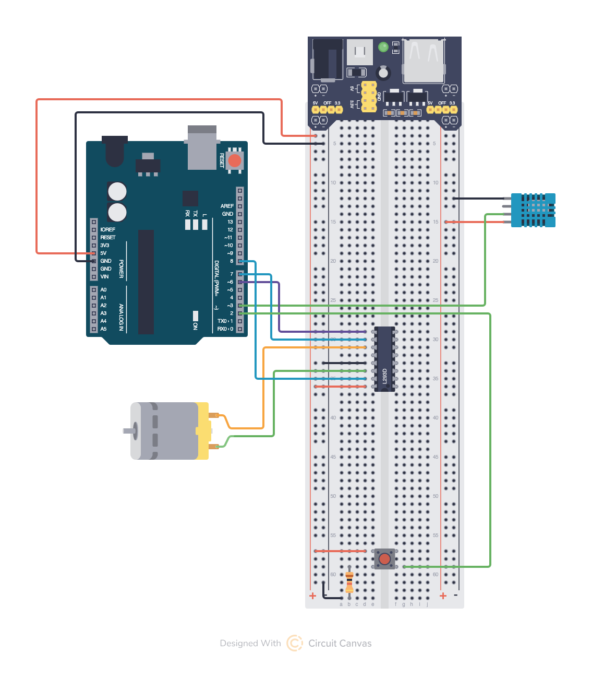
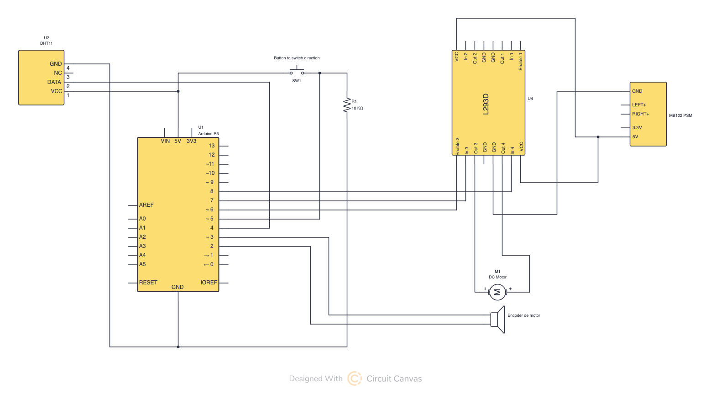

# MSSD proyecto

Universidad Carlos III de Madrid | **Máster Universitario en Robótica y Automatización**

Asignatura: *Modelizacion y Simulacion de Sistemas Dinamicos*

Curso: 2026 - 2027

Participantes:
- Stefan Oshchypok
- Anthony Manzueta Difo

## Sistema físico plateado  

Description: Sistema de control de clima.

Componentes:
- DHT11
- Button (+ 10 KOm resistencia)
- L293D DC motor driver
- DC motor con encoder
- Power Supply Module (5V o 3.3V + max 700mA)

Diagramas y esquemas:

Entradas del sistema:
- Temperatura (señal digital)
- Boton (pull-down). Cambia el sentido giratorio a traves entradas de punte H de driver.

Salidas del sistema:
- Velocidad (w(t)) de motor

## Modelización y simulation

### Limitaciones

Aquí se menciona los limites escogidos para modelo del sistema:

- *DHT11*. Es un sensor digital que envía ya los datos de entrada ([protocolo de comunicación](https://www.electronicwings.com/sensors-modules/dht11)). Por lo que no se pretende establecer una relación entre el *T(t)* y *V(t)*. Se considera como vector entrada *u(t)*.
- *L293D DC motor driver*. Al ser que su respuesta de dicho componente si lo vemos desde punta de vista de dominio electromagnético es casi instantáneo, se consider que influye de ninguna forma al motor (**ganancia 1**). Por lo que se trata dicho componente como operación identidad. Se simplifica que electronica de propio driver por sus capacidad inductivas puede influir al valores de salida como tension y corriente. En caso de querer modelar el componente habrá que describir el schema de circuito que descrita en [data sheet](https://www.ti.com/product/L293D) usando leyes de Kirchhoff.
- *DC motor con encoder*. Para modelar sera escogido un modelo continuo *DESS* basado en **sistema mecánica rotational**, la parte de circuito eléctrica de motor sera despreciada se establece que **corriente *I* sera constate (llaga a su valor de equilibrio al instante (ganancia 1))**.
- *Botón*. Sera pensado como un modelo DEVS en dominio electromagnético.

### Planteamiento

Sera en dos fases. En la primera se resuelve la modelización y simulacion + comparación con modelo físico contado dos componentes que son:
- Driver
- Motor DC con encoder

En la segunda fase, se añadirá el sensor (no se simula sino considera como entrada *u(t)*) y boton.

### Primera fase

Primero, el driver. Como se ha mencionado no se cuenta como un componente que influye a la salida de motor. Sin embargo en esta fase se considera que se rota en un sentido, o sea *DIR_A = 5V* y *DIR_B = 0V*. Al ser que se simplifica que solo se rota en un sentido (Forward) por lo que la salidas de driver sera: *OUT_A = V_in V + 700 mA* ***(pendiente de verificar valor de corriente final)*** y *OUT_B = 0 V*. Corriente de salida: **700 mA** y Rango de tensiones: **0V - 5V** (valor de corriente cogidos de este [fuente](https://wiki.elegoo.com/oshw-getting-started-&-kits/dc-motor-uno)).

Ahora se queda la parte interesante es Motor DC con encoder.

#### Motor DC

##### Parámetros físicos ***(pendiente de verificar valores)***

| Parámetro                               | Símbolo | Valor      | Unidad    |
| --------------------------------------- | ------- | ---------- | --------- |
| Momento de inercia                      | $J$     | 4,0771E-08 | kg·m²     |
| Coeficiente de fricción viscosa         | $b$     | 4,7047E-08 | N·m·s/rad |
| Constante de fuerza contraelectromotriz | $K_e$   | 0,00335915 | V·s/rad   |
| Constante de par del motor              | $K_t$   | 0,00335915 | N·m/A     |
| Resistencia de armadura                 | $R$     | 10,3       | Ω         |
| Inductancia de armadura                 | $L$     | 0,0711     | mH        |

En unidades del SI, $K_t = K_e$ (conservacion de la energía).

##### Variables del modelo

| Símbolo     | Significado                                         | Unidad    | Tipo                       |
| ----------- | --------------------------------------------------- | --------- | -------------------------- |
| $\omega(t)$ | Velocidad angular del rotor                         | rad/s     | Estado / salida            |
| $i(t)$      | Corriente de armadura                               | A         | Variable interna           |
| $v(t)$      | Tensión aplicada al motor por el driver ($=V_{in}$) | V         | Entrada                    |
| $\tau_d(t)$ | Par de carga externa                                | N·m       | Perturbación               |
| $\tau_m$    | Constante de tiempo mecánica                        | s         | Derivada de los parámetros |
| $K$         | Ganancia estática                                   | (rad/s)/V | Derivada de los parámetros |

##### Ecuaciones del motor (modelo completo, orden 2)

**Dominio mecánico** (segunda ley de Newton para rotación):

$$
J\dot\omega = \underbrace{K_t\, i}_{\text{par motor}} - \underbrace{b\,\omega}_{\text{fricción viscosa}} - \underbrace{\tau_d}_{\text{carga externa}}
$$

No hay carga externa, por lo que $\tau_d = 0$.

**Dominio eléctrico** (ley de Kirchhoff de tensiones en la armadura):

$$
L\frac{di}{dt} = v - Ri - \underbrace{K_e\omega}_{\text{fuerza contraelectromotriz}}
$$

El sistema tiene dos almacenes de energía (la bobina $L$ y la inercia $J$), es decir, dos estados $(i,\omega)$: es un sistema de **orden 2**.

##### Reducción a orden 1

> [!NOTE]
> Justification porque se desprecia la parte de dominio eléctrico sin contar es un limitation planteado para modelado. ***(pendiente de verificar valores)***

$$
\tau_e = \frac{L}{R} = \frac{0{,}0711\cdot10^{-3}}{10{,}3} \approx 7\ \mu\text{s}
\qquad\ll\qquad
\tau_m \approx 36\ \text{ms}
$$

Se supone que la corriente alcanza su valor de equilibrio de forma instantánea, $L\,di/dt \approx 0$:

$$
i = \frac{v - K_e\omega}{R}
$$

De este modo $i$ deja de ser un estado independiente y pasa a ser una función algebraica de $v$ y $\omega$. Sustituyendo en la ecuación mecánica:

$$
J\dot\omega = \frac{K_t}{R}(v - K_e\omega) - b\omega = -\Big(b + \frac{K_tK_e}{R}\Big)\omega + \frac{K_t}{R}v
$$

Se define $c \equiv b + K_tK_e/R$ y se divide toda la ecuación entre $c$:

$$
\tau_m\,\dot\omega + \omega = K\,v
$$

con

$$
\tau_m = \frac{J}{b + K_tK_e/R}, \qquad K = \frac{K_t}{bR + K_tK_e}
$$

Despejando $\dot\omega$:

$$
\dot\omega = \frac{1}{\tau_m}\left(K\,v - \omega\right)
$$

Con los valores de la tabla: $\tau_m \approx 0{,}0357$ s y $K \approx 285$ (rad/s)/V. ***(pendiente de verificar valores)***

##### Formulación en la tupla DESS (primer orden)

La tupla del modelo continuo, $M = \langle U, X, Y, f, \lambda \rangle$, queda definida como:

- **Entrada ($U$)**: $u(t) = v(t) \in \mathbb{R}$ (tensión aplicada por el driver L293D).
- **Estado ($X$)**: $x(t) = \omega(t) \in \mathbb{R}_{\geq 0}$ (la velocidad angular, asociada a la inercia $J$).
- **Salida ($Y$)**: $y(t) = \omega(t) \in \mathbb{R}_{\geq 0}$, con $\lambda(u,x) = x$.
- **Función de dinámica ($f$)**:

$$
\dot{\omega}(t) = f(u,x) = \frac{1}{\tau_m}\left( K\, v(t) - \omega(t) \right)
$$

**Significado de cada término**

- $x(t) = \omega(t)$: variable de estado (velocidad angular del ventilador, en rad/s).
- $u(t) = v(t)$: señal de entrada (tensión aplicada por el driver L293D, en V).
- $\tau_m$: constante de tiempo mecánica equivalente, en s. Es el tiempo que tarda el ventilador en alcanzar el $63{,}2\,\%$ de su velocidad final ante un escalón de tensión. Incluye el efecto de la fricción viscosa y el de la fuerza contraelectromotriz.
- $K$: ganancia estática del motor, en (rad/s)/V. En régimen permanente ($\dot\omega=0$) se cumple $\omega_{ss} = K\,v$, es decir, los rad/s que se ganan por cada voltio aplicado.

##### Tupla DTSS (primer orden)

$$
\text{DTSS}_{\text{motor}} = \langle U, X, Y, \delta, \lambda, \Delta t \rangle
$$

###### Discretización por Euler hacia adelante

Se parte de la ecuación diferencial del DESS:

$$
\dot\omega(t) = \frac{1}{\tau_m}\big(K\,v(t) - \omega(t)\big)
$$

Se evalúa el sistema solo en instantes separados por un paso fijo $T_s$, es decir, $t_k = kT_s$, y se escribe $\omega(k) \equiv \omega(kT_s)$.

Por definición, la derivada es

$$
\dot\omega(t) = \lim_{h\to0}\frac{\omega(t+h)-\omega(t)}{h}
$$

Si en lugar de $h\to0$ usamos el paso finito $h=T_s$, tenemos la aproximación de **Euler hacia adelante**:

$$
\dot\omega(kT_s) \approx \frac{\omega(k+1)-\omega(k)}{T_s}
$$

**Aplicación a la ecuación**

Se iguala esa aproximación al lado derecho de la EDO evaluado en el instante $k$:

$$
\frac{\omega(k+1)-\omega(k)}{T_s} = \frac{1}{\tau_m}\big(K v(k) - \omega(k)\big)
$$

Se multiplica por $T_s$ y se despeja $\omega(k+1)$:

$$
\omega(k+1) = \omega(k) + \frac{T_s}{\tau_m}\big(K v(k)-\omega(k)\big)
$$

Se agrupan los términos en $\omega(k)$ y en $v(k)$:

$$
\boxed{\omega(k+1) = \Big(1 - \frac{T_s}{\tau_m}\Big)\omega(k) + \frac{T_s\,K}{\tau_m} v(k)}
$$

###### Definición de elementos

- **Espacio de estados ($X$)**: $x(k) = \omega(k) \in \mathbb{R}_{\geq 0}$ rad/s (velocidad angular del rotor en el instante $kT_s$).
- **Espacio de entradas ($U$)**: $u(k) = v(k) \in \mathbb{R}_{\geq 0}$ V (tensión suministrada por el driver L293D en el instante $kT_s$).
- **Espacio de salidas ($Y$)**: $y(k) = \omega(k) \in \mathbb{R}_{\geq 0}$ rad/s (medida directa de la velocidad).
- **Función de transición ($\delta$)**:

$$
\delta\big(\omega(k), v(k)\big) = \omega(k+1) = \left( 1 - \frac{T_s}{\tau_m} \right)\omega(k) + \left( \frac{T_s K}{\tau_m} \right) v(k)
$$

- **Función de salida ($\lambda$)**: $y(k) = \lambda\big(\omega(k)\big) = \omega(k)$ (formulación de Moore).
- **Intervalo de muestreo ($\Delta t$)**: $\Delta t = T_s$ s.

Lectura intuitiva

$$
\underbrace{\omega(k+1)}_{\text{velocidad futura}} =
\underbrace{\left( 1 - \frac{T_s}{\tau_m} \right)\omega(k)}_{\text{inercia que conserva}} +
\underbrace{\left( \frac{T_s K}{\tau_m} \right) v(k)}_{\text{empuje que da la tensión}}
$$

Desglose y definiciones

- $T_s$ $(\Delta t)$: período de muestreo, intervalo fijo (en s) entre dos actualizaciones del modelo.
- $\tau_m$: constante de tiempo mecánica (s), definida en el DESS.
- $K$: ganancia estática del motor, en (rad/s)/V, definida en el DESS. En régimen permanente $\omega_{ss}=K\,v$, también en el modelo discreto.

###### Condición de estabilidad numérica

La estabilidad de un sistema discreto lineal se estudia con su dinámica libre ($v(k)=0$). La ecuación de transición es

$$
\omega(k+1) = a\,\omega(k) + \frac{T_s K}{\tau_m}\,v(k), \qquad a = 1-\frac{T_s}{\tau_m}
$$

Con un solo estado, el autovalor del sistema es el propio coeficiente $a$. Con $v(k)=0$:

$$
\omega(k+1) = a\,\omega(k) \Rightarrow\ \omega(k) = a^k\,\omega(0)
$$

Por tanto $\omega(k)\to0$ si y solo si $|a|<1$ (autovalor dentro del círculo unidad):

$$
\left|1-\frac{T_s}{\tau_m}\right|<1
\ \Longleftrightarrow\
-1 < 1-\frac{T_s}{\tau_m} < 1
\ \Longleftrightarrow\
0 < \frac{T_s}{\tau_m} < 2
$$

$$
\boxed{T_s < 2\,\tau_m}
$$

**Ausencia de oscilaciones numéricas.** Si $-1<a<0$, el sistema es estable pero $\omega(k)=a^k\omega(0)$ cambia de signo en cada paso. El sistema continuo, de primer orden, no oscila nunca, luego esa oscilación es un artefacto del método. Para evitarla se exige $a\ge0$:

$$
1-\frac{T_s}{\tau_m}\ge0 \Longrightarrow\ T_s\le\tau_m
$$

**Valores para el motor** ($\tau_m \approx 0{,}0357$ s) ***(pendiente de verificar valores)***:

| Criterio                                         | Condición           | Límite de $T_s$     |
| ------------------------------------------------ | ------------------- | ------------------- |
| Estabilidad                                      | $T_s < 2\tau_m$     | $\approx 71{,}4$ ms |
| Sin oscilaciones                                 | $T_s \le \tau_m$    | $\approx 35{,}7$ ms |
| Buena precisión (8 - 12 muestras por cada $T_s$) | $T_s \le \tau_m/10$ | $\approx 3{,}6$ ms  |

###### Régimen permanente y solución exacta del DESS

Se considera una entrada constante $v(t)=u$ siendo $u=5V$ y una condición inicial $\omega(0)=x_0$. La ecuación del DESS es

$$
\tau_m\,\dot\omega + \omega = K\,u, \qquad \omega(0)=x_0
$$

**Régimen permanente.** Es el valor al que tiende $\omega$ cuando deja de cambiar, es decir, $\dot\omega=0$:

$$
\tau_m\cdot 0 + \omega_{ss} = K\,u
\;\;\Longrightarrow\;\;
\boxed{\omega_{ss} = K\,u}
$$

Con los valores de la tabla, $\omega_{ss} = K u \approx 285 \cdot 5 \approx 1425$ rad/s. ***(pendiente de verificar valores)***

**Solución exacta.** Se define el error respecto al régimen permanente:

$$
e(t) = \omega(t) - K\,u
$$

Como $K u$ es constante, $\dot e = \dot\omega$. Sustituyendo $\omega = e + Ku$ en la EDO:

$$
\tau_m\,\dot e + e + Ku = Ku
\;\;\Longrightarrow\;\;
\dot e = -\frac{1}{\tau_m}\,e
$$

Es una EDO lineal homogénea de primer orden, cuya solución es una exponencial decreciente:

$$
e(t) = e(0)\,e^{-t/\tau_m}, \qquad e(0) = x_0 - Ku
$$

Deshaciendo el cambio de variable, $\omega(t) = Ku + e(t)$:

$$
\omega(t) = Ku + (x_0 - Ku)\,e^{-t/\tau_m}
$$

que, reordenada, queda

$$
\boxed{\omega(t) = K\,u\,\big(1 - e^{-t/\tau_m}\big) + x_0\,e^{-t/\tau_m}}
$$

| Término                 | Significado                                                |
| ----------------------- | ---------------------------------------------------------- |
| $Ku\,(1-e^{-t/\tau_m})$ | Parte que sube desde 0 hasta $Ku$ por efecto de la tensión |
| $x_0\,e^{-t/\tau_m}$    | Efecto de la velocidad inicial, que se va olvidando        |

##### Especificación Formal de la Tupla DEVS Botón de control manual

El comportamiento del pulsador manual con filtro de anti-rebote (debouncing) se define mediante la 7-tupla:$$M_{\text{botón}} = \langle X, Y, S, \delta_{\text{int}}, \delta_{\text{ext}}, \lambda, ta \rangle$$

$$M_{\text{botón}} = \langle X, Y, S, \delta_{\text{int}}, \delta_{\text{ext}}, \lambda, ta \rangle$$
